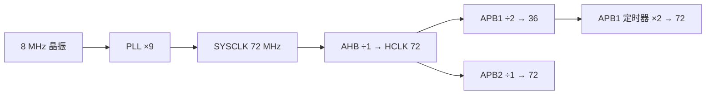

> Cornell 的用法：先写问题，再写答案。合上右栏能答出来，才算这一行过了。

## 线索栏 / 笔记栏

| 问题 | 回答 |
| --- | --- |
| 8 MHz 晶振怎么变成 72 MHz？ | PLL 倍频：`PLLMUL=9`，来源是 HSE 分频后（F103 直接用 HSE，`PLLMUL=9` → 72 MHz） |
| SYSCLK、HCLK、PCLK 谁大？ | `HCLK = SYSCLK / AHB 分频`；`PCLK1 = HCLK / APB1 分频`，F103 上 APB1 上限 36 MHz |
| 为什么定时器时钟可能是 2 倍 PCLK？ | APB 分频不为 1 时，该 APB 上的定时器时钟自动 ×2，所以 APB1 分频=2 时 TIM 仍是 72 MHz |
| 内部 8 MHz (HSI) 能替代晶振吗？ | 能，精度约 ±1%，做 UART 波特率误差会累积；时间敏感的产品不要省这颗晶振 |
| 系统启动时默认跑哪个时钟？ | HSI（保证无晶振也能起来），`SystemInit()` 才切到 PLL |

## 一图记住分频关系

## 自测（合上右栏）

1. 想要 48 MHz 的 USB 时钟，PLL 该怎么配？（提示：F103 有 `PLL / 1.5` 给 USB）
2. 把 APB1 分频从 2 改成 1 会发生什么？（答案：超过 36 MHz 限制，外设不保证工作）
3. 为什么低功耗要关未使用外设的 `RCC_APBxENR` 位？

## 总结

时钟树不是"配一个频率"，是**四条链**：源 → PLL → 总线分频 → 外设使能。任何一环没对上，现象都会伪装成"代码 bug"。上一篇 [[pwm-duty|PWM 实验]] 里 100 Hz 的波形，根因就在第二环。

> [!IMPORTANT]
> 改时钟配置后第一件事：量 MCO（PA8）输出。示波器一夹，比读十遍代码快。
