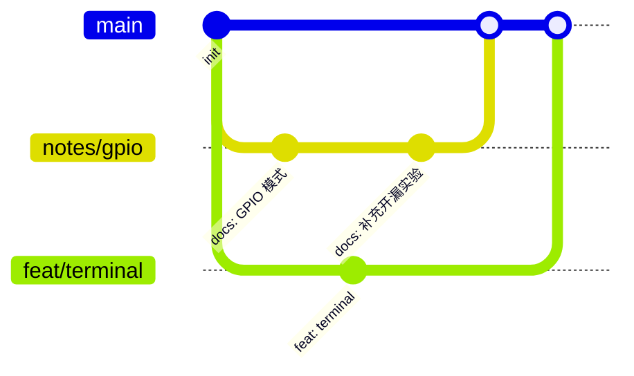

> Git 的价值不在于“能提交”，而在于半年后还能看懂当时为什么这么改。

## 最小工作流

```bash
# 1. 从最新的主分支开始
git switch main
git pull --ff-only

# 2. 为一件具体的事建分支
git switch -c feat/gpio-notes

# 3. 小步提交，每次只做一件事
git add notes/stm32-gpio.md
git commit -m "docs: add GPIO mode notes"

# 4. 推送并创建 PR
git push -u origin feat/gpio-notes
```

一个分支只解决一个问题。不要在一个分支里同时写文章、改主题、升级依赖。

## 提交信息怎么写

```text
<type>(<scope>): <what changed>

why:
- 为什么需要这个改动
```

常用类型：

| 类型 | 用途 |
| --- | --- |
| `feat` | 新功能 |
| `fix` | 修复问题 |
| `docs` | 笔记与文档 |
| `style` | 只改视觉样式 |
| `chore` | 构建、依赖、配置 |

> [!TIP]
> 如果一句话说不清这次提交在做什么，通常说明它应该拆成两个提交。

## 学习仓库的特殊约定

- **笔记与代码分开提交**：代码改动和文章更新混在一起，回滚会很痛苦。
- **实验代码也进版本库**：失败的版本同样有价值，Tag 或 commit message 里写清楚现象。
- **不要提交构建产物与密钥**：`.env`、编译输出、编辑器缓存都放进 `.gitignore`。



## 回滚之前

先问自己：是要撤销一次提交，还是要恢复某个文件？

```bash
git revert <commit>        # 生成一个反向提交，适合已经推送的历史
git restore <file>         # 丢弃工作区改动，确认没有要保留的内容
git switch -c rescue       # 不确定时，先建一个救援分支
```

> [!WARNING]
> 不要在没看清状态前运行 `git reset --hard`。它会永久丢弃未提交的改动。

## 下一步

把这套约定写成仓库根目录的 `CONTRIBUTING.md`，下次打开项目时就不用重新回忆。
