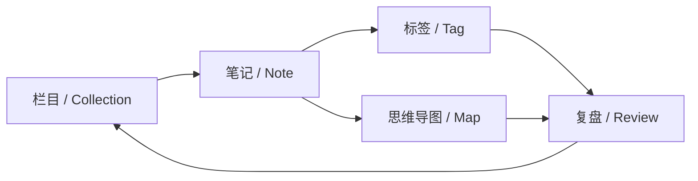

> 这不是一个“展示型博客”。它更像一台学习记录系统：栏目是我自己划的，笔记是文件，复盘是日志。

## 起因：知识散落在四个地方

过去我的学习资料分散在收藏夹、笔记软件、课程目录和脑子里。它们各自都有一点用，但合在一起回答不了一个最基本的问题：

**我现在走到哪了，下一步该写什么？**

于是我决定做一个自己的入口。它不需要复杂的后台，只要足够快、足够稳定、足够像我。

## 系统的结构

这套站点的核心不是文章数量，而是记录之间的关系：



- **栏目**回答“这条记录属于哪”。
- **笔记**回答“我究竟理解了什么”。
- **复盘**回答“下一周应该把时间投到哪里”。

三者不是并列的文件夹，而是一个闭环。

## 这套站能做什么

- 栏目完全自定义：想学什么就新建一个，不必迁就任何内置结构。
- 所有记录支持全文搜索、标签筛选、阅读时长与文章目录。
- 文章内支持 Mermaid 思维导图、KaTeX 公式、代码高亮、图片灯箱与提示块。
- 每篇文章可以单独配置视觉特效：扫描线、故障标题、信号波形、滚动显影。
- 全站有 PIXEL / LINE 两套皮肤，数据完全共用。
- 写作台支持分屏预览、字体与荧光色切换，共写频道把光标实时投到小电视。
- 一个真正能输入命令的终端模拟器，按 `~` 唤起。

> [!TIP]
> 试试在终端里输入 `help`、`ls collections`、`search 电路` 或 `theme line`。它不是装饰，真的会执行。

## 一篇文章的元数据长什么样

在 `notes/` 目录里新建一个 Markdown 文件，写清楚它属于哪个栏目：

```yaml
---
title: 基尔霍夫定律：给电路画一张收支表
date: 2026-11-04
summary: 用节点与回路两张表，解出任意线性电阻网络。
tags: 电路, KVL, KCL
collection: 电子基础
accent: cyan
fx: signal
---
```

构建脚本会把文章解析成结构化数据，自动生成目录、阅读时长与搜索索引。

<details>
<summary>隐藏的终端命令清单</summary>

- `help` 查看全部命令
- `ls collections` 列出所有栏目
- `logs` 列出最近的日志
- `search 关键词` 搜索笔记
- `theme line` 切换到线场皮肤
- `fx off` 关闭环境动效

</details>

## 最后

学习本身不会因为有了一个网站就变轻松。它的价值在于：**让每一次投入都留下可以回看的证据，让下一步不再靠感觉。**

这台系统会持续生长。下一步是继续往栏目里添笔记，把每次实验的失败与修正都写进去。

*Slow is smooth. Smooth is fast.*
