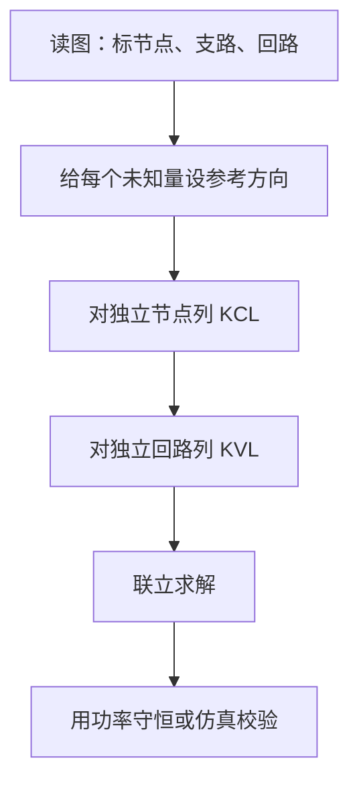

> 基尔霍夫定律不神秘。它只是电荷守恒与能量守恒，在电路里的两张账本。

## 两个定律，两句话

**KCL（基尔霍夫电流定律）**：在任意节点，流入电流的代数和等于流出电流的代数和。

$$
\sum_{k=1}^{n} I_k = 0
$$

**KVL（基尔霍夫电压定律）**：沿任意闭合回路，电压降的代数和为零。

$$
\sum_{k=1}^{n} V_k = 0
$$

它们分别对应：

| 定律 | 约束对象 | 背后的守恒 | 常用场景 |
| --- | --- | --- | --- |
| KCL | 节点 | 电荷守恒 | 求支路电流 |
| KVL | 回路 | 能量守恒 | 求元件电压 |

## 最容易错的一步：参考方向

列方程之前，先把每个电流、每个电压的**参考方向**画在图上。参考方向不是真实方向，它只是你选择的坐标轴。

- 计算结果为正：真实方向与参考方向一致。
- 计算结果为负：真实方向与参考方向相反。

> [!WARNING]
> 不要一边换参考方向、一边沿用原来的符号。方程本身没有错，错的是你偷偷改了坐标轴。

## 解题流程

一个快速检查：如果电路有 $b$ 条支路、$n$ 个节点，那么独立 KCL 方程有 $n-1$ 个。剩下的由 KVL 补齐。

## 一个小例子

两只电阻串联在 12 V 电源上：$R_1 = 2\,\text{k}\Omega$，$R_2 = 4\,\text{k}\Omega$。

先求串联电流：

$$
I = \frac{U}{R_1 + R_2} = \frac{12}{6000} = 2\,\text{mA}
$$

再分别求压降：

$$
V_{R1} = I R_1 = 4\,\text{V},\qquad V_{R2} = I R_2 = 8\,\text{V}
$$

沿回路写 KVL：

$$
12 - 4 - 8 = 0
$$

收支平衡。

为什么 KVL/KCL 在集中参数电路里总是成立？

KCL 来自电荷守恒：节点不能累积净电荷，否则电位会立刻变化。KVL 来自电场是保守场：绕闭合路径走一圈，电势变化为零。两者成立的前提是“集中参数近似”——电路的物理尺寸远小于信号波长，导线与元件外部的电磁效应可以忽略。

## 复盘

这次真正学到的不是公式，而是**先定坐标、再列方程**的习惯。后面做戴维南等效与运放分析，都会反复用到它。

> [!TIP]
> 每道题做完，用功率守恒做一次交叉验证：电源发出的功率应该等于所有电阻消耗的功率。
