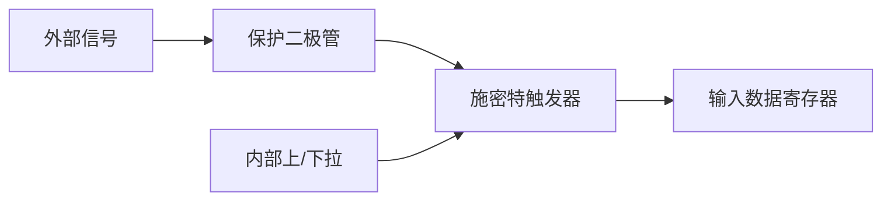

> GPIO 不是“设为输出就完事”。模式选错的代价，可能是一颗被灌坏的芯片，或者一条永远不稳定的总线。

## 输出：推挽与开漏

| 模式 | 高电平由谁拉高 | 低电平由谁拉低 | 典型用途 |
| --- | --- | --- | --- |
| 推挽 Push-Pull | 上管 | 下管 | LED、驱动数字输入、普通输出 |
| 开漏 Open-Drain | 外部上拉电阻 | 内部下管 | I2C、共享总线、电平转换 |

开漏的关键在于：它**只能主动拉低**，高电平必须靠外部上拉。因此多个开漏输出可以并联到同一根线上，谁拉低谁说话——这就是 I2C 的硬件基础。

> [!WARNING]
> 开漏输出没有外部上拉时，引脚不会得到稳定的高电平。它看起来“有时候能用”，实际上是在漂。

## 输入：浮空、上拉、下拉



- **浮空输入**：引脚电平完全由外部决定。没有明确驱动时，读数会漂。
- **上拉输入**：空闲时为高，适合按键接地。
- **下拉输入**：空闲时为低，适合按键接电源。

## 一段最小配置

以 STM32 HAL 为例，配置 PA5 为推挽输出：

```c
__HAL_RCC_GPIOA_CLK_ENABLE();

GPIO_InitTypeDef gpio = {0};
gpio.Pin   = GPIO_PIN_5;
gpio.Mode  = GPIO_MODE_OUTPUT_PP;
gpio.Pull  = GPIO_NOPULL;
gpio.Speed = GPIO_SPEED_FREQ_LOW;
HAL_GPIO_Init(GPIOA, &gpio);

HAL_GPIO_WritePin(GPIOA, GPIO_PIN_5, GPIO_PIN_SET);
```

看起来只有几行，但每一行都在回答一个硬件问题：

- 时钟没开，寄存器写了也没反应。
- 模式没选对，输出级拓扑就错了。
- 速度选错，边沿可能过冲或引入噪声。

## 调试清单

| 现象 | 先查什么 |
| --- | --- |
| 输出一直高 / 低 | 时钟、模式、是否被复用功能占用 |
| 按键抖动 | 硬件 RC、软件消抖、上下拉配置 |
| 开漏总线不通信 | 外部上拉、总线电容、地址冲突 |
| 上电瞬间误动作 | 初始化顺序、默认电平、外部负载 |

<details>
<summary>为什么点灯要用推挽，而 I2C 要用开漏？</summary>

点灯需要主动输出高电平和低电平，推挽的两个晶体管都能提供驱动能力。I2C 是多主多从的共享总线，任何设备都可能拉低线路，因此只能允许“拉低”这个动作被共享；高电平由上拉电阻统一恢复。若把两个推挽输出接在同一条线上，一个输出高、一个输出低，会形成低阻通路，电流可能损坏芯片。

</details>

## 下一单元

接下来是中断。GPIO 只解决了“我主动读写引脚”，中断才开始让外部世界主动通知 MCU。
