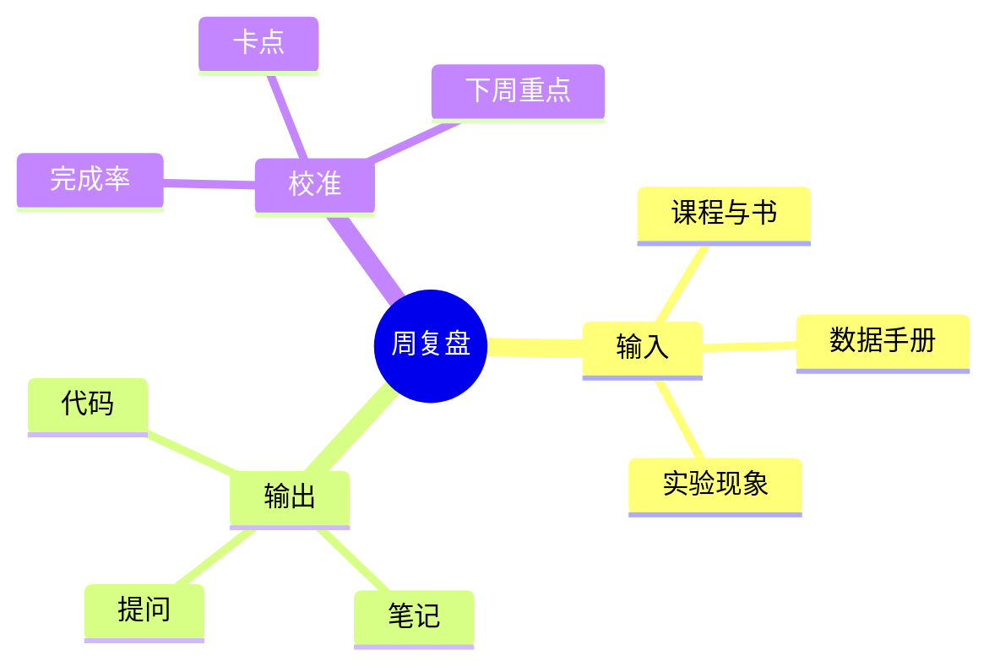

> 复盘不是给过去打分，而是给下一周减少一点不确定性。

## 复盘的三条输入



- **输入**：这周真正读完了什么，而不是“打开了什么”。
- **输出**：有没有可以运行的代码、可以复述的概念、可以检索的笔记。
- **校准**：下周应该少做什么、继续做什么、开始做什么。

## 20 分钟模板

```markdown
## 本周完成
- 栏目 / 笔记：
- 代码 / 实验：
- 笔记：

## 卡点
- 现象：
- 我试过：
- 还没排除：

## 本周最大的一个理解
（用自己的话，不看资料）

## 下周只做三件事
1.
2.
3.

## 需要放弃或延后的事
-
```

## 一个填写示例

<details>
<summary>展开看一份真实示例</summary>

**本周完成**：GPIO 推挽与开漏点灯；完成按键消抖实验；整理了 GPIO 模式表。

**卡点**：开漏输出接 LED 时亮度很低，一开始以为代码写错了。后来发现外部上拉缺失，只有内部弱上拉，驱动能力不足。

**本周最大的一个理解**：GPIO 模式不是“软件配置项”，而是输出级电路的拓扑选择。选模式之前先问：高电平由谁提供？低电平由谁提供？

**下周只做三件事**：中断与 NVIC；串口阻塞收发；把本周实验写成一篇笔记。

**延后**：暂时不碰 DMA，先把基础外设跑通。

</details>

> [!TIP]
> 如果某一周很乱，只写“卡点”和“下周只做三件事”也够了。复盘的价值在于持续，而不是格式完整。

## 月度检查

每四次周复盘后，回看一次自己的栏目与笔记：

- 哪些栏目已经两周没添新笔记了？
- 是栏目分得太细，还是时间被别的事占用了？
- 是否需要合并栏目、调整顺序，而不是继续硬扛？

栏目是地图，不是判决书。
